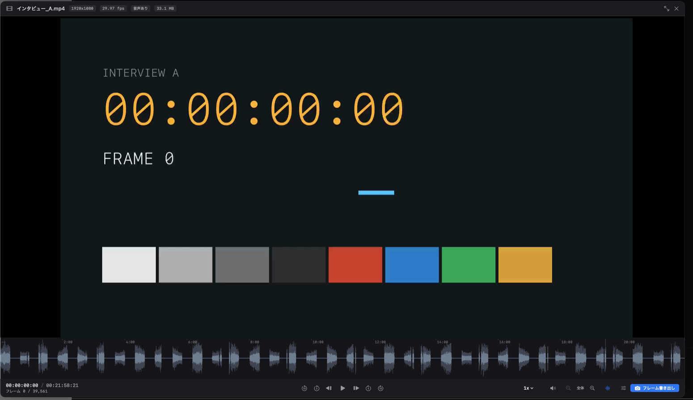
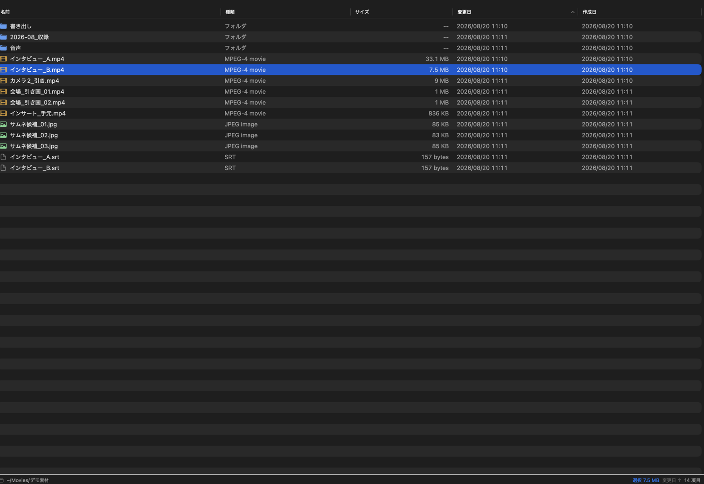
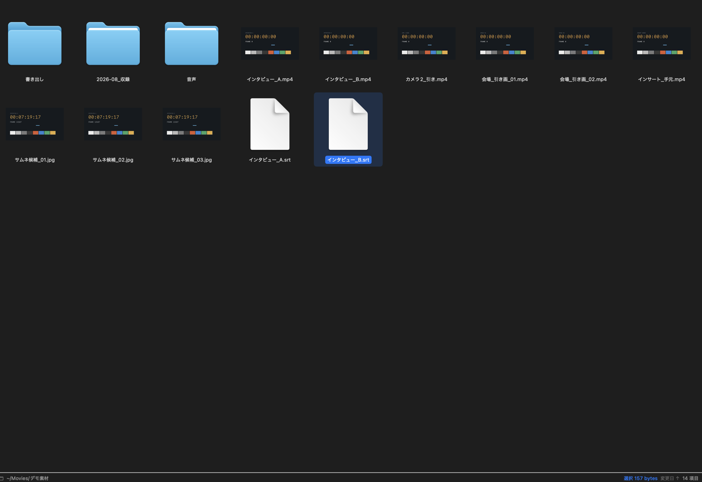
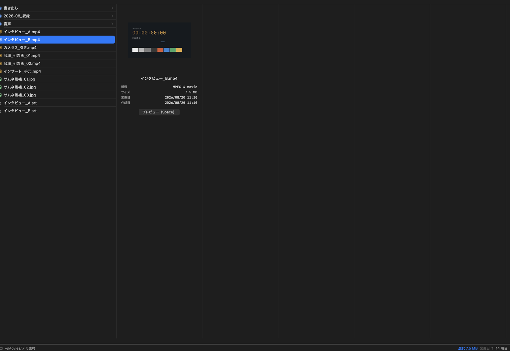
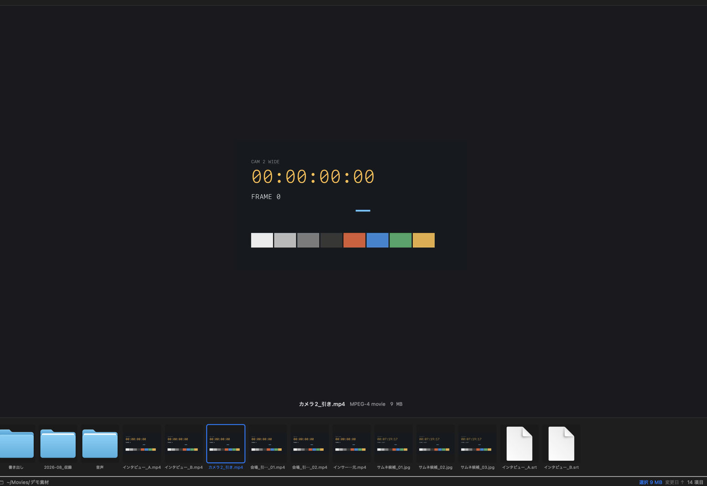
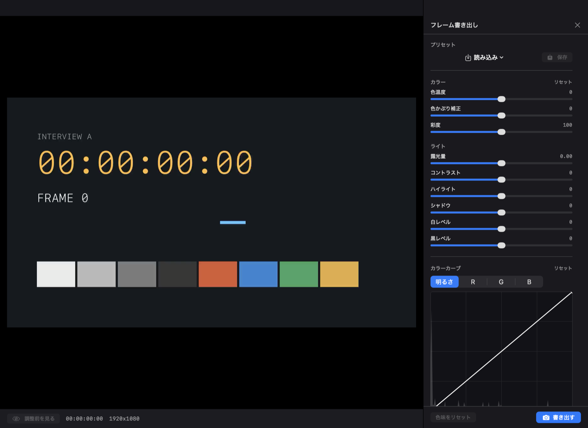

# FrameDeck

動画制作者のための macOS ファイルブラウザ。

Finder のようにファイルを見て、スペースキーでプレビューし、
**音声波形で発話位置を探し、1フレーム単位で詰めて、サムネイル用の1枚を書き出す**まで
1つのウィンドウで完結します。

<p align="center">
  
</p>

---

## なぜ作ったか

素材から YouTube のサムネイル用に1枚切り出す、という作業が Finder では完結しませんでした。

| Finder + Quick Look だと | FrameDeck だと |
|---|---|
| どこで喋っているか見えない | 音声波形が出る。ズームすれば発話の立ち上がりまで追える |
| 1フレーム単位で止められない | `←` `→` で1フレームずつ。タイムコードとフレーム番号も出る |
| サムネ1枚に別アプリが要る | `S` で書き出し。`⌥S` で色味を整えてから書き出せる |

---

## 主な機能

### ファイルブラウザ

- 表示形式4種（`⌘1` アイコン / `⌘2` リスト / `⌘3` カラム / `⌘4` ギャラリー）
- 並べ替えは Finder 同等（名前 / 種類 / サイズ / 変更日 / 作成日、フォルダを常に上部に表示）
- `⌘` クリックで追加選択、`⇧` クリックで範囲選択。選択した合計サイズがパスバーに出ます
- 十字キーだけでフォルダを辿れます（`→` で中へ、`←` で親へ）
- サムネイルは QuickLook 生成なので Finder と同じ絵が出ます

<p align="center">
  
  
  <br>
  
  
</p>

### 音声波形

`Space` でプレビューを開くと、映像の下に音声波形が出ます。**波形自体がシークバー**です。

- 誰がどこで喋っているかが形で分かります（無音の谷と発話の塊）
- `⌘+` `⌘-` で時間軸ズーム。長尺でも発話の切れ目まで詰められます
- 解析結果はディスクにキャッシュされ、2回目以降は即表示
- 解析は流し読みで進むので、長い素材でもメモリを食いません

### フレーム書き出し

- `S` でダイアログなしの即保存
- 保存先の既定は **動画と同じ場所に動画名のフォルダを作ってその中**
  （`movie.mp4` → `movie/movie_00024427.png`）
- 必ず元解像度から書き出します。同名ファイルは上書きせず連番を付けます

### 色味調整（`⌥S`）

Premiere の基本補正と同じ並びで、書き出すフレームを見ながら調整できます。
**調整は一時的なもので、元の動画ファイルには一切書き込みません。**

```
カラー   色温度 / 色かぶり補正 / 彩度
ライト   露光量 / コントラスト / ハイライト / シャドウ / 白レベル / 黒レベル
カーブ   明るさ / R / G / B（クリックで点追加、ドラッグで移動、⌥クリックで削除）
```

背景にそのフレームの輝度ヒストグラムが出るので、どこを持ち上げるか見ながら操作できます。
設定はプリセットとして保存・読み込みできます。

<p align="center">
  
</p>

### 読み取り専用

リネーム・移動・削除・新規作成は実装していません。
書き込むのはフレーム書き出しの出力先だけです。

---

## インストール

[Releases](https://github.com/ngyoc/FrameDeck/releases) から dmg をダウンロードして、
FrameDeck を Applications にドラッグしてください。

**初回だけ手間がかかります。** Apple Developer Program に未加入で公証していないため、
Gatekeeper がブロックします。

```
システム設定 → プライバシーとセキュリティ → 下の方に出ている
「"FrameDeck"は開発元を確認できないため...」の横の「このまま開く」
```

ターミナルが使えるなら、こちらの方が早いです。

```bash
xattr -dr com.apple.quarantine /Applications/FrameDeck.app
```

macOS 15 以降、以前あった「右クリック → 開く」での回避はできなくなっています。

詳しい手順は [docs/INSTALL.md](docs/INSTALL.md) にあります。

---

## ショートカット

### ファイル一覧

```
⌘1 ⌘2 ⌘3 ⌘4     アイコン / リスト / カラム / ギャラリー表示
Space           プレビューを開く
Enter           フォルダを開く / ファイルをプレビュー
↑ ↓             選択の上下
→               フォルダを開く（カラム表示では右の列へ）
←               親フォルダへ（カラム表示では左の列へ）
⌘↑ ⌘↓           親フォルダへ / 開く
⌘[ ⌘]           戻る / 進む
⌘R              Finder で表示
⌘O              デフォルトのアプリで開く
⌥⌘C             パスをコピー
⇧⌘.             隠しファイルの表示切替
```

### プレビュー中

```
Space           動画・音声 → 再生 / 一時停止
                画像・非対応ファイル → 閉じる
Esc             閉じる
F               表示を広げる
M               ミュート

← →             1 フレーム
⇧← ⇧→           1 秒
⌥← ⌥→           5 秒
⇧⌥← ⇧⌥→         10 秒
Home / End      先頭 / 末尾
0 - 9           全体の 0% - 90% へジャンプ

スクロール       1 フレーム
⇧ + スクロール   10 フレーム
⌥ + スクロール   1 秒

[ ]             再生速度 down / up
\               再生速度を 1x に戻す

W               音声波形の表示切替
⌘+ ⌘-           波形をズーム
⌘0              波形のズームをリセット

S               フレームを即時書き出し
⌥S              色味を調整して書き出し
⌘S              保存先を選んで書き出し
↑ ↓             前 / 次のファイルへ
```

---

## 対応形式

**プレビューできる**

| 種別 | 形式 |
|---|---|
| 動画 | MP4 / MOV / M4V（H.264 / HEVC / Apple ProRes / Motion JPEG） |
| 画像 | JPEG / PNG / HEIC / TIFF / GIF / WebP / 各社カメラ RAW |
| 音声 | WAV / AIFF / MP3 / M4A / AAC / ALAC / FLAC / CAF |

**プレビューできない**

MKV / WebM / VP9 / AV1 / MXF / R3D / BRAW など。
ffmpeg を同梱しない方針のためです（そのぶんアプリは 7MB 未満に収まっています）。
一覧には普通に表示され、開こうとすると理由が出て `⌘O` で外部アプリに渡せます。

---

## ビルド

Xcode 15 以降が必要です。依存パッケージはありません（Apple のフレームワークのみ）。

```bash
./scripts/build.sh      # dist/FrameDeck.app（Release / ユニバーサル / ad-hoc 署名）
./scripts/make-dmg.sh   # dist/FrameDeck-x.y.z.dmg
```

自分の Mac でビルドしたものは quarantine 属性が付かないので、そのまま起動します。

```
最低対応 OS   macOS 14.0 Sonoma
アーキテクチャ arm64 + x86_64（ユニバーサル）
アプリサイズ   約 7MB
```

### 開発用の起動引数

GUI を操作せずに動作確認するための口が用意してあります。

```bash
BIN=dist/FrameDeck.app/Contents/MacOS/FrameDeck

# 波形解析・キャッシュ・フレーム書き出し・色味調整を実素材で検証して終了
$BIN --selftest /path/to/movie.mp4

# 指定ファイルを選択してプレビューまで開いた状態で起動
$BIN --demo /path/to/movie.mp4

# ウィンドウの描画内容を PNG に書き出して終了
$BIN --screenshot out.png --screenshot-delay 5

# 一覧のクリック・キー操作を実際のイベントを合成して検証
$BIN --view-mode list --folder ~/Movies --click-test
```

---

## 技術的な選択

- **Swift + SwiftUI / AppKit ネイティブ。** ProRes / HEVC のハードウェアデコード再生、
  `AVPlayerItem.step(byCount:)` による真のフレーム精度、ランタイム不要の配布のため
- **ffmpeg を同梱しない。** AVFoundation が扱える形式に絞ることで、アプリを 7MB 未満に保ち、
  ライセンス上の制約も避けています
- **フレーム書き出しは `AVAssetImageGenerator`（許容誤差ゼロ）。**
  表示中のバッファではなく元素材から再抽出するので、解像度・回転・色空間の扱いが確実です
- **波形解析はストリーミング集計。** 全サンプルをメモリに載せないので、
  長尺素材でもメモリを食いません
- **色味調整は 1 パスの LUT。** 白レベル・黒レベルと 4 本のカーブを 256 段の LUT に焼き込み、
  `CIColorCurves` 1 回で当てます。フィルタを重ねるより誤差が乗りません

---

## まだ無いもの

- 情報ペイン（ビットレート / コーデック / 色空間 / 音声サンプルレート）
- ゼブラ・ヒストグラム・クリッピング表示
- 一括フレーム書き出し（均等 N 枚 / 前後 N フレーム）
- 検索と種類フィルタ
- フォルダの自動更新

---

## ライセンス

[MIT](LICENSE)
